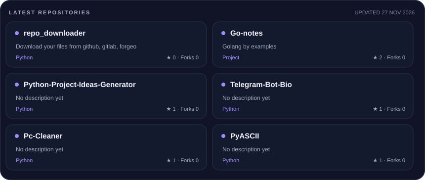

# Hey, I'm Yrashka 👋

### Python developer · Telegram bots · Automation

I build useful tools, bots, and small projects that make everyday tasks easier.

 

---

### A little about me

- 🤖 Built **20+ Telegram bots**
- ⚡ Into automation and practical software
- 🐧 Linux and Neovim user
- 🌱 Currently learning **Go**
- ✍️ I write about programming on my [blog](https://blog-yrashka.vercel.app/)

### What I use

  

### Kyiv, right now

  

### Fresh from my GitHub

  

### GitHub activity

  

  
Contribution snake

   
  <picture>
    <source media="(prefers-color-scheme: dark)" srcset="https://raw.githubusercontent.com/Yrashka200/Yrashka200/output/github-contribution-grid-snake-dark.svg" />
    <source media="(prefers-color-scheme: light)" srcset="https://raw.githubusercontent.com/Yrashka200/Yrashka200/output/github-contribution-grid-snake.svg" />
    
  </picture>

*Code. Learn. Build. Repeat.*

